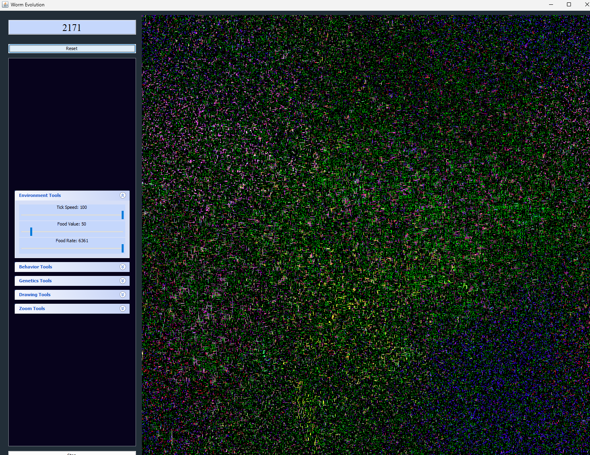
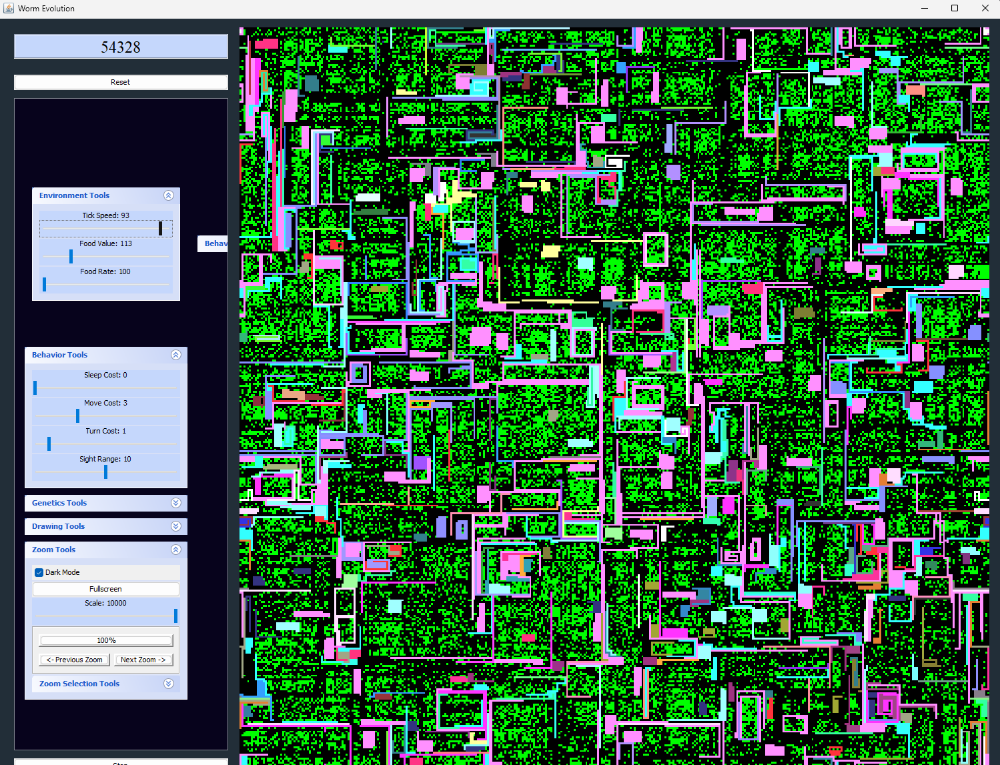
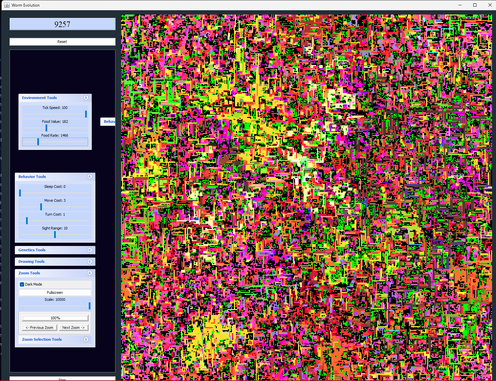

## Worms! 
An evolution simulator that applies machine learning principles to describe genetic fitness over time, built originally in Java.
## Run CLI on Windows:
```
git clone https://github.com/seanthornto/Wormvolution/
cd Wormvolution
make
run
```
## Screenshots



